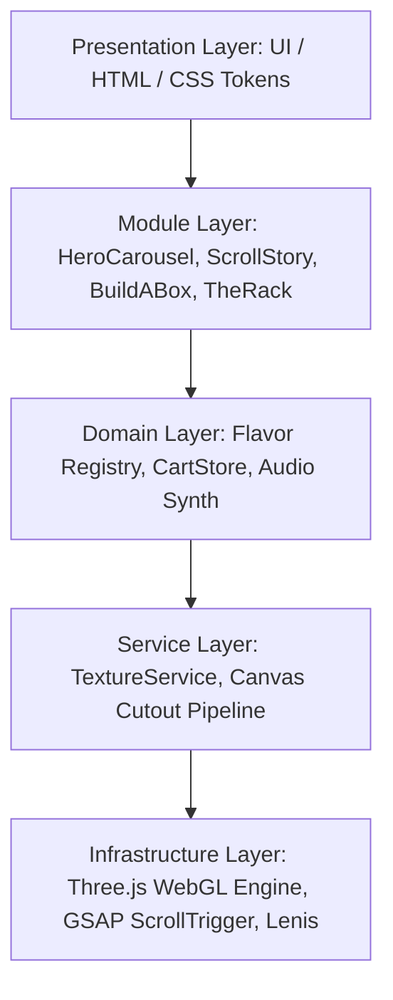

<div align="center">

# 🥔 Lay's Crunchy Experience &bull; 3D Showcase

<p align="center">
  <strong>An immersive, scroll-driven 3D web experience built with Three.js, GSAP, Lenis, and modern WebGL shaders.</strong>
</p>

[](https://threejs.org/)
[](https://greensock.com/)
[](https://vitejs.dev/)
[](https://github.com/darkroomengineering/lenis)
[](LICENSE)

<br/>


</div>

---

## 🚀 Overview

The **Lay's Crunchy Experience** is a high-performance, cinematic 3D digital showcase celebrating the iconic flavors of Lay's potato chips. Built with cutting-edge creative web technologies, it features authentic 3D pillow snack bags, dynamic flavor-themed concentric shaders, smooth momentum scrolling, and procedural audio synthesis.

---

## ✨ Key Features & 3D Interactive Highlights

### 1. 🌟 Hero 3D Arc Carousel (`Flavors`)
- **Arc Layout Mathematics:** 3D pillow bags are positioned along a curved orbital arc using trigonometric interpolation (`lerp`) and circular wrap logic.
- **Dynamic Concentric Rings Shader:** Custom GLSL radial ripple fragment shader radiating outward from behind the hero bag, smoothly blending color palettes between flavor selections.
- **Fluid Control Scheme:** Smooth drag-to-browse pointer interactions, keyboard arrow navigation, tactile circular controls, and an automated autoplay showcase mode.
- **Dynamic Retheming:** Real-time CSS variable updates (`--flavor-color`, `--flavor-deep`, `--flavor-glow`, `--flavor-ink`) coordinating lights, typography, and accents.

### 2. 📖 Inside Story & Hotspot Inspector (`Inside`)
- **Pinned Scrubbing Timeline:** Powered by **GSAP ScrollTrigger**, the section pins while the user scrubs through 4 distinct story chapters:
  - **Chapter 01:** *Built to Protect* (The Air Cushion Bag & Heat-Sealed Crimps)
  - **Chapter 02:** *Farm-Grown Roots* (Precision Potato Slicing & Harvest)
  - **Chapter 03:** *Micro-Dusted Rub* (Warm-Oil Seasoning Infusion)
  - **Chapter 04:** *Acoustic Crack* (The 65dB Auditory Crunch Signature)
- **Interactive Radar Hotspots:** 3D inspection callouts anchored over the bag highlighting foil barriers, crimp seals, and nitrogen cushion zones.
- **Chip Storm Particle System:** A high-speed celebratory burst of 3D tumbling chips and seasoning dust transitioning between narrative sections.

### 3. 🖼️ The Flavor Wall (`Shop`)
- **Stitched Tactile Cards:** Signature card design with custom dashed border stitching reflecting the authentic color tone of each flavor.
- **3D Gyroscope / Mouse Tilt:** Interactive perspective tilt physics (`perspective(800px) rotateX/Y`) reacting to user cursor movement.
- **Automated Studio Backdrop Cutouts:** Real-time canvas chroma processing removing solid studio backdrops to render crisp, transparent product cutouts.
- **Tactile Quick-Add Action:** Instant tactile button feedback dropping bags directly into the customer's build tray.

### 4. 🛒 E-Commerce Ordering System & Build-a-Box (`₹ Pricing & Checkout`)
- **Indian Rupee Currency (`₹`):** All pricing across the storefront, cards, drawer, and invoices is displayed in Rupees (`₹`).
- **Pocket-Friendly Pricing Model:**
  - **Single Flavor Packet:** **₹20** (NET WT. 50g)
  - **Build-a-Box 3-Pack Saver Bundle:** **₹50** (Regular ₹60 &bull; Save ₹10 instantly!)
  - **Delivery Promotion:** 100% **FREE Express Delivery**
- **Complete Delivery Checkout Drawer:**
  - **Full Name \***
  - **Mobile Number \*:** 10-digit validation with auto-formatting
  - **Email Address \*:** Order receipt confirmation
  - **Exact Location for Delivery \*:** Integrated with **GPS Auto-Detect Location button** using the HTML5 Geolocation API with graceful fallback
  - **Special Message / Instructions (Optional):** Delivery notes (e.g., "Leave with security", "Ring the bell")
  - **Payment Methods:** Flexible payment selection between **Cash on Delivery (COD)** and **UPI on Delivery** (GPay, PhonePe, Paytm QR scanner).
- **3D Animated Order Confirmation & Live Tracking Modal:**
  - Real-time generated unique **Order ID** (e.g. `#LAYS-557573`)
  - **3-Step Live Delivery Tracker Timeline:** *Order Confirmed (Verified)* &rarr; *Flavor Packaging (Nitro-cushion sealing in progress)* &rarr; *Express Delivery (Estimated 30-40 mins)*
  - Transparent summary card displaying recipient, contact, full address, and total amount
  - **Print Receipt** trigger & tactile **Order More Chips** loop
  - Persisted in browser `localStorage` under `lays_orders` with Indian Standard Time (IST) timestamps

### 5. 🪝 The Rack (`Range`)
- **Metallic Hanging Rod:** Bags hanging from realistic chrome clips and tags (`01` through `09`).
- **Hook Spin Physics:** Click or tap any bag on the rack to send it spinning on its hook with natural rotational damping.
- **Precision Dial Scrubber:** Tactile horizontal radio tuner / dial with millimeter tick marks and active orange needle indicator.

### 6. 🔊 Synthesized Web Audio Engine
- **Zero MP3 Bloat:** Uses the native **Web Audio API** to procedurally synthesize sound effects in real-time:
  - *Auditory Crisp Crunch:* Filtered white noise decay with exponential frequency ramps.
  - *Foil Rustle:* Bandpass-filtered pink envelope simulating foil crinkles.
  - *Tactile Snaps & Clicks:* Resonant sine tone pops for buttons and UI toggles.

---

## 📸 Visual Showcase

<div align="center">

| Hero Carousel & Dynamic Shader | Pinned Story & Hotspot Callouts |
| :---: | :---: |
|  |  |

| The Flavor Wall (3D Tilt Cards) | Build-a-Box Turntable Concept Store |
| :---: | :---: |
|  |  |

| The Rack (Hanging Rod & Dial) | Cinematic Preloader & Sound Synth |
| :---: | :---: |
|  |  |

</div>

---

## 🛠️ Architecture & Tech Stack



- **Framework & Bundler:** [Vite 5](https://vitejs.dev/)
- **3D Graphics & Rendering:** [Three.js r169](https://threejs.org/) (Custom BufferGeometry, PBR MeshPhysicalMaterial, custom GLSL Shaders)
- **Scroll & Timeline Choreography:** [GSAP 3](https://greensock.com/) + [ScrollTrigger](https://greensock.com/scrolltrigger/)
- **Smooth Momentum Scrolling:** [Lenis](https://github.com/darkroomengineering/lenis)
- **Audio Synthesis:** Native Web Audio API (`AudioContext`, `BiquadFilterNode`, `GainNode`)
- **Typography:** Archivo Black, Inter, JetBrains Mono

---

## 📦 Getting Started & Local Development

### Prerequisites
- [Node.js](https://nodejs.org/) (v18.0.0 or higher recommended)
- `npm` or `yarn`

### Installation

1. **Clone the repository:**
   ```bash
   git clone https://github.com/SHARABUMANOJKUMAR/Lays-Crunchy-Website.git
   cd Lays-Crunchy-Website
   ```

2. **Install dependencies:**
   ```bash
   npm install
   ```

3. **Start the development server:**
   ```bash
   npm run dev
   ```
   Open your browser and navigate to `http://localhost:3000/` (or the displayed port).

4. **Build for production:**
   ```bash
   npm run build
   ```
   The optimized production bundle will be output to the `dist/` folder.

---

## 🗂️ Project Directory Structure

```text
lays-crunchy-website/
├── docs/
│   ├── api.md                 # Service & Store documentation
│   └── style-guide.md         # Locked design tokens & rules
├── public/
│   └── packs/                 # High-resolution Lay's packet artwork
├── screenshots/               # Showcase screenshots
├── src/
│   ├── domain/
│   │   ├── cartStore.js       # Reactive cart & 3-pack bundle state
│   │   └── flavors.js         # 9 Flavor definitions & color palettes
│   ├── modules/
│   │   ├── buildABox.js       # Concept store customizer
│   │   ├── cartDrawer.js      # Slide-out basket & checkout
│   │   ├── flavorWall.js      # 3D tilting flavor cards
│   │   ├── heroCarousel.js    # Arc carousel & dynamic retheming
│   │   ├── preloader.js       # Cinematic chip seasoning sequence
│   │   ├── scrollStory.js     # GSAP ScrollTrigger chapters & hotspots
│   │   └── theRack.js         # Hanging rod & precision dial wheel
│   ├── scene/
│   │   ├── bagGeometry.js     # Procedural 3D pillow bag geometry
│   │   ├── chipfield.js       # Floating chips & particle storm
│   │   ├── concentricRings.js # Dynamic GLSL concentric ripple shader
│   │   └── sceneManager.js    # Master Three.js camera & lighting engine
│   ├── services/
│   │   ├── audioService.js    # Web Audio API crunch & rustle synthesizer
│   │   └── textureService.js  # High-res canvas texture & cutout pipeline
│   ├── styles/
│   │   ├── main.css           # Global layout & component styles
│   │   └── tokens.css         # Centralized design system tokens
│   └── main.js                # Application bootloader
├── index.html                 # Semantic HTML entry
├── package.json
└── vite.config.js
```

---

## 📜 License & Acknowledgments

- **Concept & Inspiration:** Fan portfolio exploration inspired by Lay's branding and modern 3D creative web design.
- **Trademarks & Artwork:** Lay's logo and product artwork belong to PepsiCo / Frito-Lay.
- **Code License:** [MIT License](LICENSE) &copy; 2026 Sharabu Manoj Kumar.

---

<div align="center">

### 💡 Developed by [Shaivika IT Technologies (shaivikaittechnologies.in)](https://shaivikaittechnologies.in)

</div>
