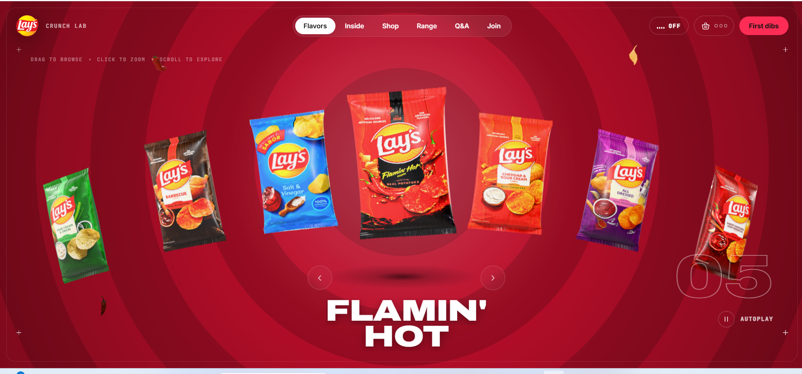
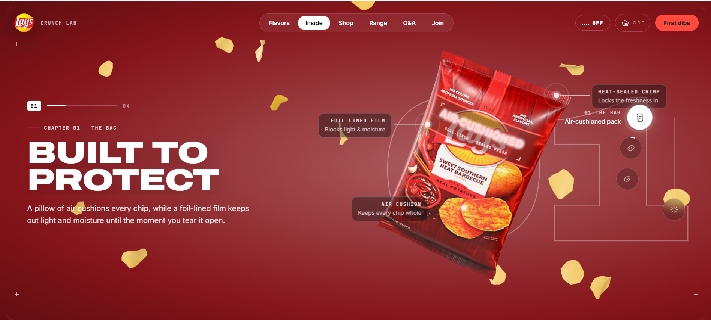
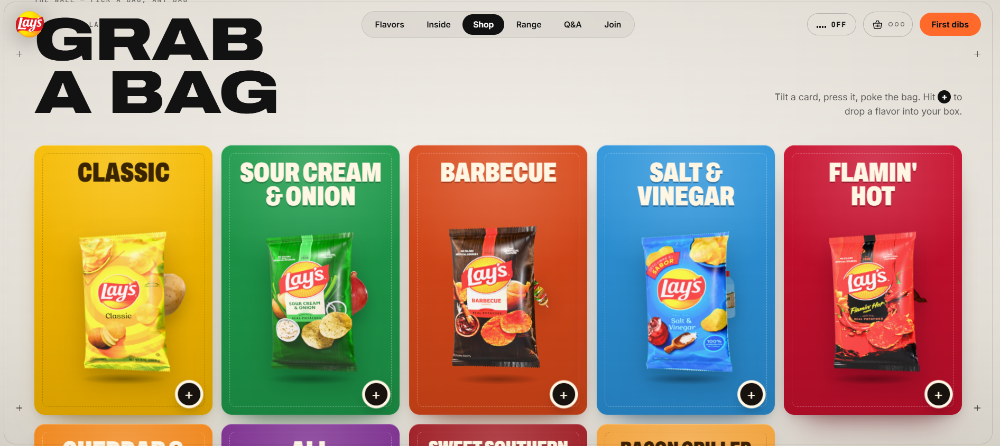
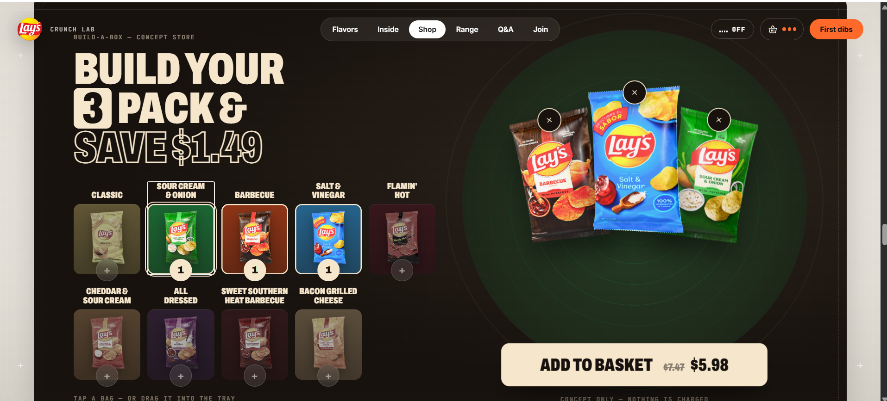
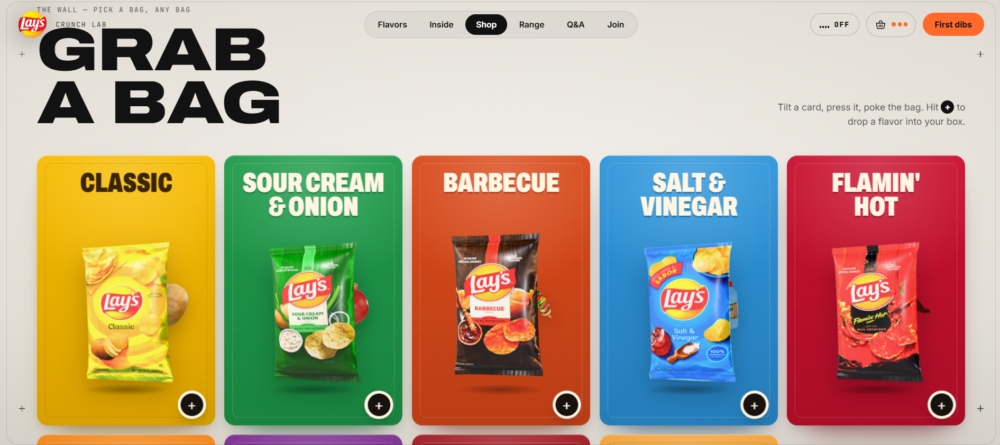
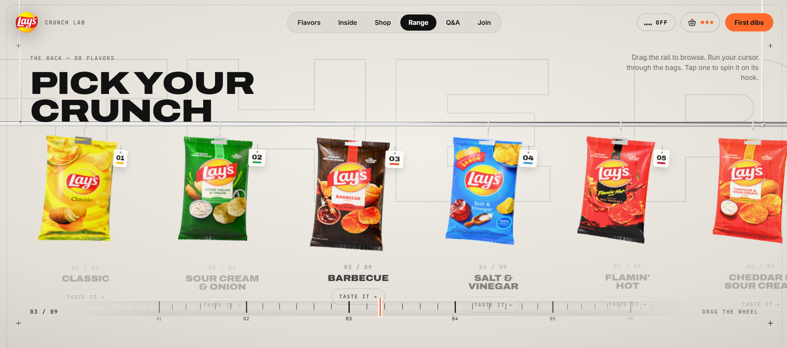

# Lay's Crunch Experience

A scroll-driven, 3D flavor showcase for Lay's chips: a cinematic preloader, a hero carousel of real 3D bags, a story section, a flavor wall with a Build-a-Box shop, and "The Rack". It runs in the browser on Three.js, GSAP and Lenis.

> Fan/portfolio project. Pack art and logo belong to their owners. 3D ingredient models are Sketchfab CC BY. The source code lives in a separate private repo.

## Screenshots













## Docs

- [Pseudocode](PSEUDOCODE.md)
- [Prompts](PROMPTS.md)
- [How we did it](HOW-WE-DID-IT.md)

## Stack

Vite · Three.js · GSAP + ScrollTrigger · Lenis (smooth scroll) · plain JS and CSS · Python (Pillow) asset prep scripts.

## Pseudocode

### Boot
```
on load:
    start preloader (chip storm loop)
    create smooth scroll (Lenis), keep it stopped
    create 3D Experience (one WebGL canvas, one scene)
    load pack textures, HDR environment, ingredient models in parallel
    update preloader % as assets arrive
    when all ready:
        preloader: season the hero chip -> burst -> reveal page
        start Lenis, play hero intro timeline
```

### Hero carousel
```
bags = one 3D bag mesh per flavor, arranged on an arc
active = DEFAULT_FLAVOR
each frame:
    for each bag i:
        offset = wrap(i - active)                 # shortest circular distance
        target.position/rotation/scale = arcLayout(offset)
        bag.pose = lerp(bag.pose, target, damping)
    rings background: blend previous flavor colors -> new colors
                      outward from the center behind a feathered front
on arrow / drag / swipe / autoplay tick:
    active = (active +- 1) mod N
    retheme page (CSS vars from flavor.color / deep / glow / ink)
    animate title lines in
```

### Scroll story
```
one pinned ScrollTrigger timeline over the story section:
    progress 0..1 -> chapters 1..4
    scrub the bag rotation, camera dolly and hotspot callouts
    swap backdrop word and chapter bar per chapter
    after the story, a "storm" of chips crosses the screen
```

### Shop (Wall + Build-a-Box)
```
wall: one tall card per flavor
    image = transparent cut-out rendered from the real 3D bag
    on hover: ingredient pops up from behind the bag
box:  pick 3 flavors -> each lands in a tray slot (animated)
      basket counter and dots update; tray full -> enable checkout CTA
```

### Pack texture pipeline (offline, `tools/prep_packs.py`)
```
for each flavor photo:
    if "shot":   remove white backdrop automatically
    if "photo":  crop to the pack box
    unwarp the pillow outline so print lies flat
    lay out crimped seals matching the 3D bag geometry
    export 1024x1536 jpg, art edge to edge
```

## Prompts we used

The site was built iteratively with Claude Code. The prompts below are paraphrased, in the order they mattered.

1. **Concept.** "Build a premium, scroll-driven Lay's website with real 3D bags, flavor theming and a cinematic loader. Make it feel tactile and alive."
2. **Packaging.** "Use the real pack art from lays.com, with the on-pack flavor names, mapped onto 3D bags. I'll supply the images myself where the site blocks bots."
3. **Hero.** "Keep the hero minimal. Show the real 3D ingredients printed on the center bag, two or three small ones per flavor. Use flavor-colored rings as the background."
4. **Shop.** "Add a flavor Wall and a Build-a-Box picker between the storm section and The Rack. Put the rail after the 3-pack."
5. **The Rack.** "Turn the Range into The Rack. Make the UI tactile, in the style of the 'Websites in 2026' reference reel."
6. **Mobile.** "Phones and tablets should keep the laptop composition. Use a stable viewport and make sure it works on Safari and Windows."
7. **Performance.** "Make it load fast: optimize models (meshopt, WebP), shrink the HDR, and show real progress in the loader."
8. **Publish.** "Push the source to a private GitHub repo and make a public repo with screenshots, pseudocode, prompts and how we did it."

## How we did it

1. **Scaffold.** Vite project with Three.js, GSAP, Lenis and fontsource fonts (Archivo variable, Inter, JetBrains Mono, Pacifico).
2. **One canvas, many sections.** A single fixed WebGL canvas (`scene.js`) sits behind the HTML. Scroll position and carousel state are shared values that the 3D scene reads each frame, so bags can move between sections without a second renderer.
3. **Bags.** `bag.js` builds a pillow-shaped bag with crimped seals. `textures.js` generates fallback artwork, and the real art from `public/packs` replaces it when present.
4. **Pack art.** `tools/prep_packs.py` cleans raw photos into flat 1024x1536 textures (background removal, unwarp, seal layout).
5. **Ingredients.** `ingredients.js` and `chipfield.js` float small Sketchfab models and the ring background around the hero. Models are optimized with gltf-transform (512px WebP, meshopt).
6. **Choreography.** GSAP ScrollTrigger scrubs the story chapters and Lenis gives the smooth scroll. Mobile URL-bar resizes are ignored so the timeline doesn't jump.
7. **Shop.** `shop.js` renders cut-out product images straight from the 3D bags, so the shop always matches the hero.
8. **Preloader.** `preloader.js` runs the chip storm, then the hero chip spins and is seasoned while assets load.
9. **Polish.** Same layout on mobile as on laptop, a stable viewport, Safari and Windows testing, and fast-load tuning (compressed HDR, lazy extras).

## Run it yourself

The source is private. If you have access: `npm install`, then `npm run dev`.

